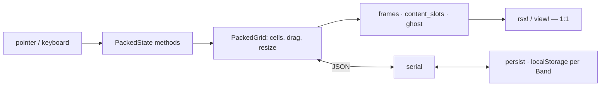

# Architecture

A packed-grid tiling layout: tiles have a fixed starting size, snap to a step grid,
never overlap, and leave whitespace below (InsilicoTerminal's look). One engine
(`tilers_core`) drives two bindings (`tilers_dioxus`, `tilers_leptos`).

## The one idea

Everything a renderer would keep in reactive cells lives on **one plain struct**,
`PackedState`, and every event is a `&mut self` method taking already-extracted
primitives. The binding does the DOM read and passes numbers and strings in; it gets
back plain view-model data (`frames`, `content_slots`, `ghost`) with inline styles
already computed, which a template renders 1:1. Keyboard input is the exception: decoding a
`KeyboardEvent` (`KeyInput: From<&KeyboardEvent>`, the editable check) and detecting the platform
live in core, so the two bindings can't diverge on what a keystroke is.

So the whole gesture machine — drag, resize, undo, refit, keybinds, the seed cache —
is ordinary Rust, testable without a DOM, and shared verbatim by both bindings. A
binding is a few hundred lines of glue holding exactly one reactive cell.

Content is the other half: one absolutely-positioned wrapper **per panel** in a stable
id-keyed list, positioned over its tile's measured box. That overlay is why a panel
keeps its component instance (and inner JS state, e.g. a live map) while being dragged
across the grid.

## Codemap

`tilers_core`:
- `model/packed` — the grid itself: `Cell` rects in step units, the skyline `pack`,
  `settle` (gravity toward the top, with the pinned tile claiming its row first),
  `resolve_target`/`drop`, `refit` for a column-count change, and `resized`, the one resize: an
  edge moves its own tile, pushing what it grows into. The no-overlap invariant lives here
  (`assert_packed`).
- `model/group` — a tile's tab-group: many panels, one active.
- `model/serial` — versioned JSON. `PackedGrid` *is* the serialized value; the schema
  tag is the seam for migrations, and `load` errors on a younger payload rather than
  silently wiping a workspace.
- `state` — the reducer over `PackedState`: gestures, undo history, `on_key` and command
  dispatch, the measure/refit path, the view-model getters (incl. `hint`/`help`), and the
  **band latch** (below).
- `keys` — `Keymap` (leader, scope, root) of `Binding`s, its per-platform resolution into a
  chord trie, and `KeyInput` normalization (the `key` sent, case from Shift alone).
- `config` — `Config` (steps/row height/keymap/storage key/publish hook),
  `Breakpoint` (5 widths, sets the column count) and `Band` (3 widths, the persistence
  key).
- `persist` — `localStorage` read/write, wasm-only (a native no-op), crate-internal.
- `css` — the one structural stylesheet; colors and sizes are `--tl-*` custom properties.

Bindings (`tilers_dioxus`, `tilers_leptos`) hold `PackedState` in one reactive
cell, forward DOM events into it, render the view-model, and expose `PackedApi` — a cheap
handle over that cell — to the host through `on_band`.

`tilers_grafana` is a *host* of the Leptos binding, not a third binding: a Grafana app
plugin (`plugin/`, TS + `@grafana/scenes`) whose wasm half mounts `PackedArea` with one bare slot
per panel, and the plugin portals each panel's native `VizPanel` into its slot. Everything
Grafana-shaped — the save-model conversion, the `gridPos` seed, an empty `Keymap::root` (Grafana owns Ctrl+Z) —
stays inside that crate. It is released as a plugin zip on `grafana-v*` tags, not to crates.io.

## The seed cache

A layout is stored per `Band` (`sm`/`md`/`xl`), not per `Breakpoint`: neighbouring
breakpoints differ only in column count, which `refit` handles, while a phone-sized
arrangement is genuinely worth keeping apart from a desktop one.

`PackedState::take_band` is the latch. Both bindings call it after *every* measure; it
returns `Some(restored)` only when a real step size has landed and the band differs from
what is on screen — i.e. once per band entry. On that edge it resets the grid, and, if
`Config::storage_key` is set, tries `localStorage` under `<key>-<band>`. The binding then
invokes the host's `on_band`, which sees `api.restored()` and either re-attaches content
to the restored tiles or lays out a fresh spread.

The framework caches on `leader s`, says so in its toast (`notice`), and **never talks to a
server**. `leader S` caches the same way, then hands the JSON to `Config::on_publish`; a host that
wants a site-wide default persists it itself, behind its own authorization, reports the outcome
through the same toast (`notify`), and `load`s it in `on_band` when the cache missed. The hook runs
in a microtask after the keydown, so it may `notify` synchronously. Precedence is therefore: client cache → host default → host built-in seed.

## Invariants

- `PackedState` is the sole source of truth; every interaction is a `&mut self` mutation.
- Cells never overlap, mid-gesture too, and nothing is ever left hanging: `settle` pulls every tile
  up onto the skyline of the tiles above it.
- A resize is a pure function of the layout at the press, the grip and the cursor: the live grid is
  re-derived from the press layout on every move, and an edit landing mid-gesture lands on that
  layout. So dragging back restores what the gesture shrank, and the path never matters.
- A grip takes its own tile only. A boundary between two tiles is the left one's right grip alone,
  and moving it away leaves the right one where it is; growing pushes the tiles it reaches. A left
  grip exists only where a left edge has room beside it, never at the view's edge: a nested dock's
  edge sits on its host's boundaries. For the same reason, in a framed view (its document in a
  frame, or its root in another dock's tile) no grip runs along the band a host's grip may cover,
  guessed as the view's last two grip-thicknesses and border: a tile on the view's right edge or
  reaching its bottom has a `Wall`/`Fold` just before that band instead, which only shrinks it.
  Unframed, nothing lies past the view's edges, so the plain grips stay. A
  horizontal grip never changes a height: a tile's `y` moves only by settling.
- The content overlay's render order is **independent of layout** — never reorder it, or
  instances remount and stateful panels (maps, scroll, focus) reset.
- `focused`/`maximized` are overlay state beside the grid, never cells; they are filtered
  through `live()` so a stale id is inert. `drag`/`resize` address cells, so anything that
  replaces them (`reset`, and hence the band latch, and `load`) must clear them too.
- Pixel layout is the browser's job; the model is unit-free steps. Measured boxes and the root's
  scroll offset are the only re-entries of pixels, and whether the root is framed the one DOM fact.
- Content keeps a tile's whole body below the title bar; the edge grips are strips over its edges,
  and its scrollbars stop short of the corner and leave their outer edge to the grip.
- One gesture at a time: a drag can't start while a resize is in flight, nor a resize while a drag
  is.
- A row is a fixed length (`Config::row_h_rem`): the container's height decides only how much of
  the layout shows, never where a tile is or how tall. Only its width reflows.
- A min belongs to the panel (`DockPanel::min`), not the tile. A cell's floor is derived from its
  tabs' declared mins at the live step, on every measure and tab change; never stored as layout.
- A cached layout that is corrupt, from a future schema, or empty is a **miss** that says
  so on the console — never a silent wipe.
- The framework's global key footprint is exactly `Keymap::root` ∪ {leader} ∪ {Esc while the
  help, an inspect popup or a chord is open}. Everything else waits behind the leader.
- A key aimed at an editable never acts, so text undo and typing stay native.
- A bind matches the `key` the user's layout produced, never the physical `code`: the layout is
  unknowable from the page, so reading a position as a letter assumes one (qwerty) and binds a key
  other than the one the user pressed. A layout that sends no bound key (Cyrillic, macOS Option's
  `†`) acts on nothing; a host wanting it binds those keys too.
- The reducer is time-free; any delay (the which-key reveal) is presentation, in CSS; any cadence
  (drag autoscroll) is the binding's frame loop, stepping the reducer once per frame.

## References

- `docs/refs/dockview/packages/dockview-core` was the port source for the original split-tree design; the
  packed grid replaced it, so it is history rather than a spec.
- insilicoterminal (the visual target) is a *custom* Vue split-tree, not a library — only
  the look is taken from it.
